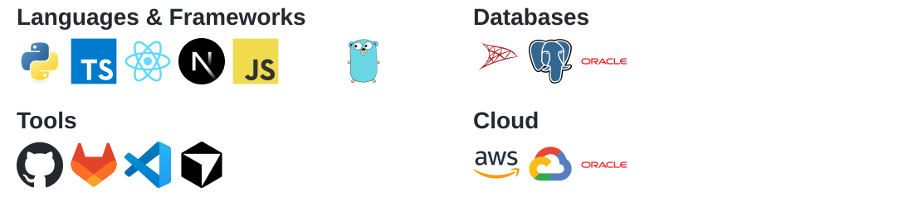
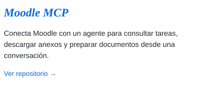
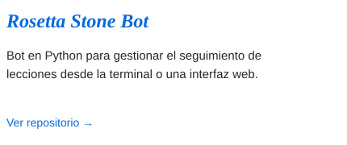
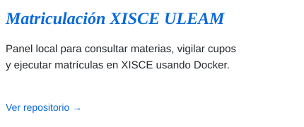
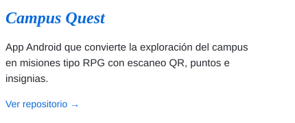

<picture>
  <source media="(prefers-color-scheme: dark)" srcset="./assets/profile-title-dark.svg" />
  
</picture>

### AI Backend Developer

---

<picture>
  <source media="(prefers-color-scheme: dark)" srcset="./assets/skills-grid-dark.svg" />
  
</picture>

---

## 🚀 Featured Projects

  <a href="https://github.com/ElkinDelgado25/Moodle_Homework_assignment"><picture><source media="(prefers-color-scheme: dark)" srcset="./assets/project-card-moodle-dark.svg" /></picture></a>
  &nbsp;
  <a href="https://github.com/ElkinDelgado25/Bot_Rosetta_Stone"><picture><source media="(prefers-color-scheme: dark)" srcset="./assets/project-card-rosetta-dark.svg" /></picture></a>

  <a href="https://github.com/ElkinDelgado25/Matriculacion_Xisce_Uleam"><picture><source media="(prefers-color-scheme: dark)" srcset="./assets/project-card-matricula-dark.svg" /></picture></a>
  &nbsp;
  <a href="https://github.com/Erickelrojo-22/campus-quest-app"><picture><source media="(prefers-color-scheme: dark)" srcset="./assets/project-card-campus-dark.svg" /></picture></a>

